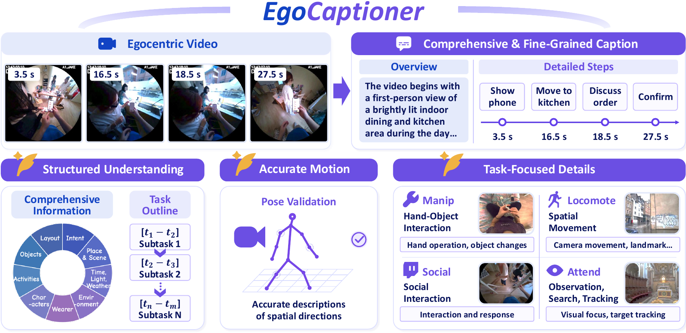

# 👁️ EgoCaptioner: Towards Comprehensive and Fine-Grained Egocentric Video Captioning

[](https://huggingface.co/Vickyinmyheart824/EgoCaptioner)

---

## ✨ Overview

EgoCaptioner describes first-person video with a video-level overview and timestamped steps. The overview establishes the scene and the camera wearer's activity. The steps describe how the activity unfolds, with details on manipulation, locomotion, social interaction, and visual attention.

Built on Qwen3.5-9B, it is trained with coarse-to-fine caption supervision and reinforcement learning for factual content, temporal alignment, and caption style.



## 🚀 Getting Started

Requires Linux x86-64 and an NVIDIA Ampere, Ada or Hopper GPU with BF16 support and a driver compatible with CUDA 12.8.

### 1. Clone the repository

```bash
git clone https://github.com/cactusqq/EgoCaptioner.git
cd EgoCaptioner
```

### 2. Set up the environment

For the single-video examples, run all three commands. The last step builds CUDA extensions with the CUDA 12.8 toolkit (`nvcc`) and a C++ compiler. For JSONL input, run the first two commands and continue to [Batch Inference](#-batch-inference).

```bash
conda env create -f environment.yml
conda activate egocaptioner
python -m pip install --no-build-isolation --no-deps -r requirements-kernels.txt
```

<details>
<summary>TorchCodec cannot find the FFmpeg shared libraries</summary>

If the error mentions a missing library such as `libavcodec.so`, let the dynamic linker search the active Conda environment first. Run this in the same shell as inference.

```bash
export LD_LIBRARY_PATH="$CONDA_PREFIX/lib${LD_LIBRARY_PATH:+:$LD_LIBRARY_PATH}"
```

</details>

### 3. Quick usage

`--model` accepts `Vickyinmyheart824/EgoCaptioner` or a local checkpoint directory. Captions are printed to the terminal, and `--output` also saves them to a text file.

**Full-video captioning**: an overview followed by timestamped steps.

```bash
python infer.py --model Vickyinmyheart824/EgoCaptioner --video video.mp4 --task full --output outputs/full.txt
```

**Overview captioning**: a video-level description.

```bash
python infer.py --model Vickyinmyheart824/EgoCaptioner --video video.mp4 --task overview --output outputs/overview.txt
```

**Event-conditioned captioning**: locate a named event in the video and describe its steps.

```bash
python infer.py --model Vickyinmyheart824/EgoCaptioner --video video.mp4 --task event_steps \
  --event "I wash the cup" --output outputs/event_steps.txt
```

`--event` is a short English description of the target activity, with "I" for the camera wearer. If the activity repeats, add context to pick the occurrence, e.g. `"I wash the cup after placing the plate on the rack"`. Prompt templates are in [`prompts/`](prompts/).

## ⚡ Batch Inference

In the activated environment, install vLLM:

```bash
python -m pip install -r requirements-batch.txt
```

Write a JSONL file with one task per line, see [`examples/videos.jsonl`](examples/videos.jsonl):

```jsonl
{"id":"clip1-full","video":"videos/clip1.mp4","task":"full"}
{"id":"clip1-overview","video":"videos/clip1.mp4","task":"overview"}
{"id":"clip2-event","video":"videos/clip2.mp4","task":"event_steps","event":"I wash the cup"}
```

`video` is resolved relative to the JSONL file. `task` defaults to `full`, `event_steps` requires `event`, and `id` is optional. Then run:

```bash
python infer_batch.py --model Vickyinmyheart824/EgoCaptioner \
  --input videos.jsonl --output outputs/captions.jsonl
```

Results are written as JSONL in completion order, and failed rows are recorded as errors without stopping the run. To resume or retry failed rows, add `--resume`:

```bash
python infer_batch.py --model Vickyinmyheart824/EgoCaptioner \
  --input videos.jsonl --output outputs/captions.jsonl --resume
```

Use a new output path if you change the model or the input.

## 📄 License

Code is released under [Apache-2.0](LICENSE). EgoCaptioner is derived from [Qwen3.5-9B](https://huggingface.co/Qwen/Qwen3.5-9B), also Apache-2.0.
